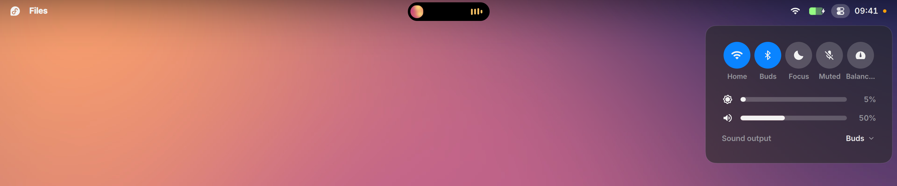
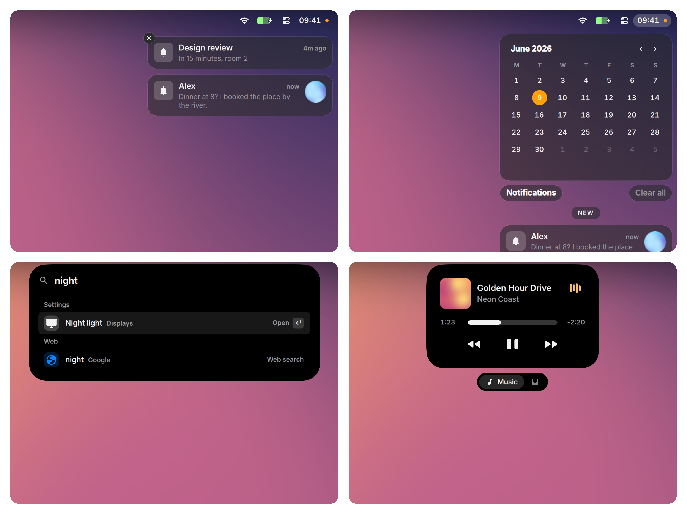
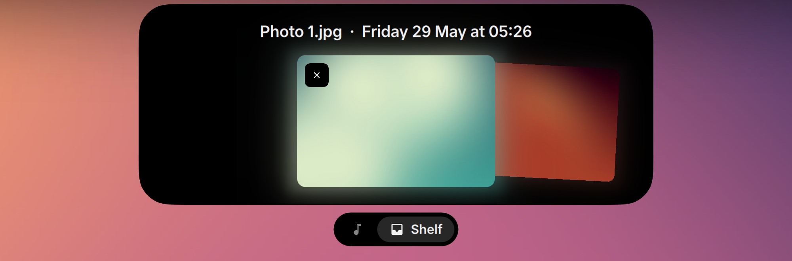

# niri-island

A macOS-style top bar with a Dynamic Island notch for the [niri](https://github.com/YaLTeR/niri) Wayland
compositor, built with [Quickshell](https://quickshell.org). The bar shows where you are and what your
computer is doing, and every icon in it opens what's behind it. The notch in the middle shows what
happens right now: the music playing, your volume keys, alerts.

It is a community project, not part of niri.



## What it does

**The bar** (white icons over a soft shade, readable on any wallpaper):

- At the left, your distribution's logo (places, search, lock, log out, restart, shut down), the app
  you're in (fullscreen, maximize, float, center or close its window), and, if you turn them on
  (`bar.workspaces.show`), your workspaces as dots: click a dot to go there, around them for niri's
  overview.
- At the right, the apps' tray icons, then Wi-Fi, battery, quick settings and the clock.
  Each opens its **dropdown** right under it, in frosted glass (niri's blur):
  - **Wi-Fi** and **Bluetooth** (from quick settings): a switch and the networks / devices nearby; connect, pair.
  - **Battery**: the level, the time left, and the power mode.
  - **Quick settings**: Wi-Fi, Bluetooth, Focus (do not disturb), microphone, power mode, brightness,
    volume and where the sound goes.
  - **Calendar**: the month, today circled, and your notifications under it.

  Everything works from the keyboard too (arrows, Tab, Enter, Space, Escape). A click outside, or on the
  bar's empty space, closes it.
- **Search** (a shortcut): the notch grows into a search field with your favourites and every app
  under it; type, and it finds apps, files, calculations, web searches and
  the desktop's settings (with [niri-settings](https://github.com/NiteChill/niri-settings)).
- **Wallpaper** (from the search or the logo's menu): a carousel of your wallpapers.



**The notch** (what happens now, in order of importance):

- Volume, brightness and microphone feedback for your keys (it replaces an OSD like swayosd).
- Low battery, charging, headphones, Wi-Fi connected, and a handwritten goodbye when you power off.
- The music playing: its cover and moving bars, the whole time it plays. Click it for the controls.

**The shelf**: the notch holds things. Drop files on it and they're kept in a folder of its own
(`~/Island`); every screenshot lands there too. Click the notch to open the player or the shelf (when
both have something, small tabs under the notch switch between them); open, show, copy or drag the
files back out into any app. Files that aren't pictures show their preview (PDFs, videos, documents) or
their type's icon.



**Notifications**: the shell is your notification server (it replaces mako, dunst or swaync). They
slide in at the top right, like macOS, several at once, and wait while your pointer is on them. Swipe
one up to put it away (it stays in the history), right to delete it. Click the clock to see them all
again under the calendar, new and old (they're kept across reboots). Clicking one brings up the window
that sent it. Screenshots arrive as a card with the picture; take several and they pile up on it.

Its font, Allo, comes with it: nothing to install. Everything you can see is a setting: sizes, colours,
corners, springs, timings, icons, texts. `config/schema.json` describes every one of them; your choices
go in `config/config.jsonc`.

## Works with niri-settings

[niri-settings](https://github.com/NiteChill/niri-settings) is a settings app for niri, the system
and this island, made to go with it. Each works without the other; together:

- The Settings app has a **Dynamic Island** page (which alerts show, search) and options spread where
  you'd look for them (notifications, sound, appearance). Its island look options (blur, attached to
  the top) belong to the previous, island-only version and do nothing here yet.
- They share the system's settings: the accent colour, the 12 / 24-hour clock, Focus and the wallpaper
  are the desktop's, so changing one in either place changes both.
- The island's search finds the Settings app's settings ("night light" opens that page).
- Clicking a system notification (network, Bluetooth, printers...) opens the matching Settings page.


Without the island, niri-settings simply hides the island's options; without the Settings app, the
island's settings are in `config/config.jsonc`.

## What you need

Required:

| What | Fedora | Arch |
|---|---|---|
| niri (tested with 26.04) | `niri` | `niri` |
| Quickshell 0.3 or newer, built with Qt 6.9 or newer | [COPR `errornointernet/quickshell`](https://copr.fedorainfracloud.org/coprs/errornointernet/quickshell/) | `quickshell` (AUR) |
| PipeWire with its PulseAudio server (`pactl`, `pw-play`) | `pipewire-utils`, `pipewire-pulseaudio`, `pulseaudio-utils` | `pipewire`, `pipewire-pulse`, `libpulse` |
| GLib tools (`gsettings`, `gdbus`) and the desktop's setting schemas | `glib2`, `gsettings-desktop-schemas` | `glib2`, `gsettings-desktop-schemas` |
| UPower, NetworkManager, BlueZ (battery, Wi-Fi, Bluetooth) | `upower`, `NetworkManager`, `bluez` | `upower`, `networkmanager`, `bluez` |
| Python 3 | `python3` | `python` |
| `wl-copy`, `file`, `find` | `wl-clipboard`, `file`, `findutils` | `wl-clipboard`, `file`, `findutils` |

Optional:

- `brightnessctl`: brightness keys and the brightness slider (laptops).
- `cava`: the music bars follow the real sound (otherwise they dance on their own).
- `python3-gobject` (Fedora) / `python-gobject` (Arch): drag files from the shelf into sandboxed apps (Flatpaks).
- Thumbnailers for the shelf's previews (on GNOME-based systems they come with Files, Papers, the GStreamer plugins...).
- A file manager that supports "show in folder" (Files, Dolphin...), and `xdg-utils`.
- [niri-settings](https://github.com/NiteChill/niri-settings).

Turn off any other notification daemon (mako, dunst, swaync) and OSD (swayosd): the island takes their
place.

## Install

1. Put the island where Quickshell looks for its default config (move an existing
   `~/.config/quickshell` aside first):

   ```sh
   git clone https://github.com/NiteChill/niri-island ~/.config/quickshell
   ```

2. Start it with niri, and give it your keys, in `~/.config/niri/config.kdl`:

   ```kdl
   spawn-at-startup "qs"

   binds {
       Mod+Space { spawn "qs" "ipc" "call" "island" "toggle" "search"; }
       Mod+S     { spawn "qs" "ipc" "call" "island" "toggle" "quickSettings"; }
       XF86AudioRaiseVolume allow-when-locked=true { spawn "qs" "ipc" "call" "osd" "volume" "up"; }
       XF86AudioLowerVolume allow-when-locked=true { spawn "qs" "ipc" "call" "osd" "volume" "down"; }
       XF86AudioMute        allow-when-locked=true { spawn "qs" "ipc" "call" "osd" "volume" "mute"; }
       XF86AudioMicMute     allow-when-locked=true { spawn "qs" "ipc" "call" "osd" "mic" "mute"; }
       XF86MonBrightnessUp   allow-when-locked=true { spawn "qs" "ipc" "call" "osd" "brightness" "up"; }
       XF86MonBrightnessDown allow-when-locked=true { spawn "qs" "ipc" "call" "osd" "brightness" "down"; }
   }
   ```

   (Put the binds inside your existing `binds { }` block.) Anything opens with
   `qs ipc call island toggle <name>`: `search`, `quickSettings`, `wifi`, `bluetooth`, `battery`,
   `calendar` (with the notifications), `media`, `shelf`, `wallpaper`. niri-settings' Keyboard > Shortcuts
   page can set these for you.

3. Log out and back in, or start it now with `qs &`.

**Update:** `git -C ~/.config/quickshell pull` (it reloads by itself). The previous, island-only
version stays available as the `v0.1-island` tag.
**Uninstall:** remove `~/.config/quickshell` and the lines above.

## Settings

`config/config.jsonc` lists every setting, commented out at its default: uncomment a line to change it.
The shell reloads as soon as you save. `config/schema.json` explains each one (what it changes, its
range). After editing, `python3 tools/check-config.py` checks the file.

## Licence

GNU General Public License v3.0 or later: see `LICENSE`. The icons are Material Symbols (Apache-2.0)
and the font is Allo (SIL Open Font License 1.1): see `THIRD-PARTY.md`.
